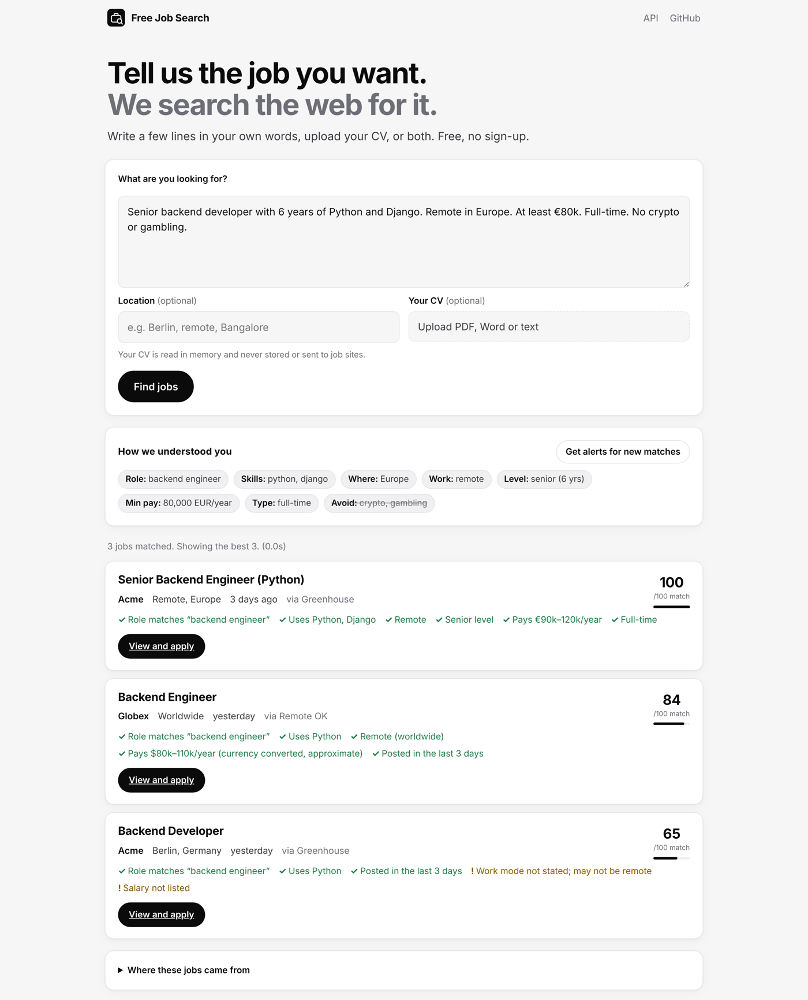

<div align="center">


# Free Job Search API

**Your own job search API. Free forever, no API keys, no quotas.**

Write a few lines about the job you want, or upload your CV, and get the best matching jobs
from company career pages, public job boards and the web: ranked, explained and linked to the original posting.

[](https://github.com/Ethos6/free-job-search-api/actions/workflows/ci.yml)
[](https://github.com/Ethos6/free-job-search-api/actions/workflows/live.yml)
[](LICENSE)


[Quick start](#quick-start) · [API](#api) · [CV upload](#search-with-your-cv) · [Alerts](#alerts) · [MCP](#mcp-server-for-ai-agents) · [Sources](#where-jobs-come-from) · [Config](#configuration)



<sub>Screenshot with sample data from the offline demo (<code>scripts/demo_server.py</code>).</sub>

</div>

## Example

```bash
curl -s localhost:8000/v1/search -H 'content-type: application/json' -d '{
  "requirements": "Backend developer, 6 years with Python and Django. Remote in Europe or hybrid in Berlin. At least €80k. Full-time. No crypto or gambling companies."
}'
```

```jsonc
{
  "requirements": {                      // how your words were understood
    "titles": ["backend engineer"], "skills": ["python", "django"], "work_modes": ["remote", "hybrid"],
    "places": [{"name": "Europe", "kind": "continent"}, {"name": "Berlin", "country": "DE", "kind": "city"}],
    "seniority": "senior", "years_experience": 6, "salary_min": 80000, "salary_currency": "EUR",
    "employment_types": ["full_time"], "exclude": ["crypto", "gambling"]
  },
  "results": [{
    "score": 96,
    "job": { "title": "Senior Backend Engineer (Python)", "company": "…", "location": "Remote, Europe",
             "url": "https://job-boards.greenhouse.io/…", "source_name": "Greenhouse",
             "salary": {"min": 90000, "max": 120000, "currency": "EUR"}, "posted_at": "2026-10-15T…" },
    "reasons": ["Role matches “backend engineer”", "Uses Python, Django", "Remote", "Senior level", "Pays €90k–120k/year"],
    "warnings": []
  }],
  "total_found": 37,
  "sources": [{"id": "index", "jobs": 412}, {"id": "web", "jobs": 18}, {"id": "linkedin", "skipped": "off by default …"}]
}
```

## What it understands

Write the way you'd tell a friend. The built-in parser needs no AI and no keys:

| You write | It understands |
| --- | --- |
| "backend developer", "SRE", "Go engineer", "beekeeper" | 68 role families with 400+ ways to say them, or the words you used |
| "Python, Django, k8s, Figma, patient care" | 285 skills, 400+ names with aliases |
| "ideally Kubernetes", "AWS is a plus" | nice-to-have skills |
| "Berlin", "Bangalore", "remote in Europe", "UK", "LATAM" | cities, countries, regions (2,000 cities, all countries) |
| "I live in Pune", "based in Lisbon" | where you live, so remote jobs limited to other countries are skipped |
| "remote", "hybrid", "fully remote", "not fully remote" | work mode |
| "junior", "6 years of experience", "senior" | level |
| "$120k", "€80,000 a year", "35 LPA", "£45/hour", "12000 AED per month", "$80-100k" | minimum salary, currency and period |
| "full-time", "contract", "part-time is fine", "internship" | job type |
| "need visa sponsorship", "I have a Blue Card" | visa needs |
| "posted in the last 2 weeks" | freshness |
| "no crypto or gambling", "not interested in agencies", "avoid Amazon" | things to avoid |
| "I speak German and English" | languages (warns when a job asks for one you didn't list) |

Optional AI: point `JOBS_LLM_URL` at any OpenAI-compatible API (a free local [Ollama](https://ollama.com) works)
for even better understanding of long requests and CVs, and AI re-ranking of the top matches.

## Search with your CV

Upload a CV (PDF, Word `.docx` or text). The API reads your recent job titles, skills, years of
experience (from the dates on your CV), seniority, location and languages. Add a location or a few
lines and they take priority over the CV.

```bash
curl -s localhost:8000/v1/search/cv -F cv=@my_cv.pdf                                  # CV only
curl -s localhost:8000/v1/search/cv -F cv=@my_cv.pdf -F location="remote" \
     -F requirements="no agencies, at least \$100k"                                     # CV + your wishes
```

**Privacy:** the CV is read in memory, in a separate process with strict limits, and never stored,
logged or sent to job sites. Only short search words (like "data engineer python Bengaluru") leave the
server, and the CV text is not echoed back. If you turn on an outside AI service, the CV goes to that service.

## Quick start

**Docker Compose (recommended, includes your own web search engine)**

```bash
git clone https://github.com/Ethos6/free-job-search-api && cd free-job-search-api
cp .env.example .env
docker compose up -d        # web page and API on http://localhost:8000, docs at /docs
```

The first start fills a local job index from the company boards and job boards in the background;
searches get richer over the first few minutes.

**pip**

```bash
pip install "free-job-search-api[mcp] @ git+https://github.com/Ethos6/free-job-search-api"
jobsearch serve                                   # http://localhost:8000
jobsearch search "nurse in Berlin, speak German" --refresh
jobsearch search --cv my_cv.pdf --location remote
```

**Try it offline** (sample data, no internet needed): `python scripts/demo_server.py 8010`

## API

Interactive docs are at `/docs`.

| Endpoint | What it does |
| --- | --- |
| `POST /v1/search` | `{"requirements": "...", "location": "...", "limit": 25}` → ranked jobs with reasons |
| `GET /v1/search?q=...` | the same, as a GET |
| `POST /v1/search/cv` | multipart: `cv` file, optional `requirements`, `location`, `limit` |
| `POST /v1/understand` | see how a request is understood, without searching |
| `GET /v1/sources` | every source, whether it's on, and what it asks of us |
| `POST /v1/alerts` | save a search (see below) |

Every job comes with a `score` out of 100, plain-language `reasons` and `warnings` (e.g. "Salary not
listed", "Remote only for people in: US"), the original `url`, the `source_name` to credit, and
`also_on` links when the same job appears on several sources.

## Alerts

Save any search and get new matches as they appear: by **webhook** (Slack, Discord, Zapier, your app) and
a private **RSS feed**. No email address needed.

```bash
curl -s localhost:8000/v1/alerts -H 'content-type: application/json' \
  -d '{"requirements": "senior react developer, remote", "every_hours": 24, "webhook_url": "https://hooks.example.com/abc"}'
# -> {"id": "...", "token": "...", "feed_url": ".../v1/alerts/<id>/feed.xml?token=..."}
```

On the web page, press **Get alerts for new matches** after a search (this works for CV searches too,
without sending the CV again).

## MCP server for AI agents

Let Claude, Cursor or any MCP client search jobs for you:

```json
{ "mcpServers": { "jobsearch": { "command": "jobsearch", "args": ["mcp"] } } }
```

Tools: `search_jobs(requirements, location, limit)`, `search_jobs_from_cv(cv_text, requirements, location, limit)`,
`job_sources()`.

## Where jobs come from

| Source | How | Notes |
| --- | --- | --- |
| **Company career boards**: Greenhouse, Lever, Ashby, Workable, Recruitee | official public job-board APIs, indexed locally | Starts with about 150 verified companies (Stripe, OpenAI, Airbnb, Databricks, Notion, SpaceX, Spotify…) and **grows by itself**: every board found through web search or in job posts is added. Add your own with `JOBS_COMPANIES`. |
| **SmartRecruiters** | public API, searched live | large employers (Bosch, Accor, Sodexo, Ubisoft…) |
| **Remotive, Remote OK, Jobicy, Arbeitnow** | free public job-board APIs, indexed | each credited and linked, as they ask |
| **The Muse, Himalayas** | public APIs, searched live | |
| **Hacker News "Who is hiring?"** | public HN Algolia API | the monthly thread, parsed into jobs |
| **The web** | your own [FreeSearch API](https://github.com/Ethos6/free-search-api) | finds postings anywhere; reads the [schema.org JobPosting](https://schema.org/JobPosting) data sites publish for search engines |
| **LinkedIn, Indeed, Glassdoor…** | public pages, **off by default** | see below |

**About LinkedIn, Indeed, Glassdoor and similar sites.** Their terms forbid automated access. By default
the API never fetches their pages; when web search finds one of their postings, it shows the title and the
link so you can open it yourself. If you run the API and accept that responsibility, `JOBS_ENABLE_BIG_SITES=1`
turns on LinkedIn's public (logged-out) job search and reading their job pages. Even then: no login, no
CAPTCHA solving, no disguised browsers, no proxy rotation. If a site refuses, the API backs off and skips it.
Most jobs on those sites are also on the employer's own career board, which the API reads directly.

**Being a good citizen.** The API identifies itself honestly, paces requests per site, caches results,
refreshes its index every few hours instead of on every search, and always links to the original posting
and names the source.

## How ranking works

Each job is scored out of 100: role and title 35, skills 25, location and work mode 15, seniority 10,
salary 10, freshness 5. Hard filters remove jobs you ruled out: things to avoid, a work mode or place you
can't do, pay clearly below your minimum (other currencies are converted approximately and labelled so),
postings older than you asked for, and remote jobs open only to people in other countries. Duplicates
across sources are merged, keeping the company's own posting.

## Configuration

All optional. See [`.env.example`](.env.example).

| Variable | Default | Meaning |
| --- | --- | --- |
| `JOBS_SEARCH_URL` | – | FreeSearch API base URL for web search (set by docker-compose) |
| `JOBS_LLM_URL`, `JOBS_LLM_MODEL`, `JOBS_LLM_KEY` | – | optional OpenAI-compatible AI (e.g. Ollama) |
| `JOBS_API_KEYS` | – | require `X-API-Key` (comma-separated keys) |
| `JOBS_RATE_LIMIT` | `20` | searches per minute per client |
| `JOBS_COMPANIES` | – | extra boards, e.g. `greenhouse:acme,lever:example` |
| `JOBS_SOURCES` | all | only use these source ids |
| `JOBS_REFRESH_HOURS` | `6` | how often the local index is refreshed |
| `JOBS_ENABLE_BIG_SITES` | `0` | LinkedIn / Indeed / Glassdoor pages (see above) |
| `JOBS_TIMEOUT` | `20` | seconds a search may take |
| `JOBS_DATA` | `./data` | where the index database lives |
| `JOBS_BASE_URL` | `http://localhost:8000` | public address, used in alert links |
| `JOBS_TRUST_PROXY` | `0` | set `1` behind a reverse proxy |

## Development

```bash
pip install -e ".[dev]"
pytest -q                      # 105 tests, no internet needed
python scripts/live_check.py   # searches the real sources (needs internet)
```

The **Live check** workflow runs real searches against the real sources every week.

## License and credits

[MIT](LICENSE). City and continent data from [GeoNames](https://www.geonames.org) (CC BY 4.0); country
names from ISO 3166. Job listings belong to the employers and job boards they come from; this project
only links to them. Not affiliated with any job board or employer.
